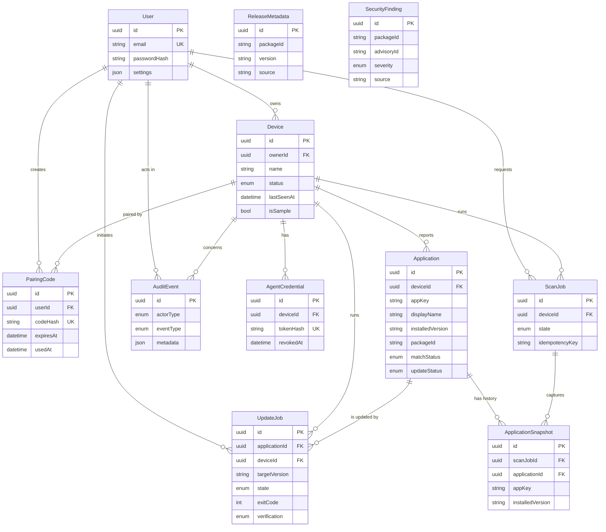

# UpdatePilot: Database Design (ERD)

Status: Draft for team review (Day 3)
Schema: `apps/api/prisma/schema.prisma`
Database: PostgreSQL 16, accessed through Prisma ORM

## 1. Entity relationship diagram

`ReleaseMetadata` and `SecurityFinding` are linked to applications logically through `packageId`, not through a foreign key. They are cached per package and shared by every device, so they must not depend on one device's rows.

## 2. Tables

| Table | Purpose | Notes |
|---|---|---|
| `User` | Account identity | Password stored only as a hash. `settings` holds theme, scan, notification and retention preferences |
| `Device` | A paired Windows computer | Owned by one user. `isSample` marks demo data |
| `AgentCredential` | Credential an agent uses to call the API | Only a hash is stored. Revoked or rotated, never edited in place |
| `PairingCode` | One-time pairing code | Hashed, short-lived, single use |
| `Application` | Current inventory entry for a device | One row per app per device, identified by `appKey` |
| `ScanJob` | A scan request and its outcome | State, timestamps, error summary, idempotency key |
| `ApplicationSnapshot` | What a scan saw | Immutable history, so evidence is never overwritten |
| `ReleaseMetadata` | Cached release info per package version | Source and fetched time recorded |
| `UpdateJob` | A confirmed update and its outcome | Exit code, restart flag, verification result |
| `AuditEvent` | Audit trail | Actor, device, event type, target, safe metadata |
| `SecurityFinding` | Verified advisories | Stored only when package match and source are reliable |

## 3. Constraints

| Constraint | Why |
|---|---|
| `User.email` unique | One account per email |
| `AgentCredential.tokenHash` unique | Credentials resolve to exactly one device |
| `PairingCode.codeHash` unique | Codes cannot collide |
| `Application (deviceId, appKey)` unique | Scan upserts are idempotent; no duplicate apps per device |
| `ApplicationSnapshot (scanJobId, appKey)` unique | A scan records each app once |
| `ScanJob (deviceId, idempotencyKey)` unique | A retried request does not create a second scan |
| `UpdateJob (deviceId, idempotencyKey)` unique | A retried or replayed confirm does not create a second update |
| `ReleaseMetadata (packageId, version, channel, source)` unique | One cached row per release per source |
| `SecurityFinding (packageId, advisoryId, source)` unique | No duplicate findings |
| Foreign keys everywhere | Orphan rows are impossible |

Postgres treats NULL values as distinct in unique constraints, so rows without an idempotency key do not conflict.

## 4. Delete behavior

| Parent deleted | Children |
|---|---|
| `User` | Devices, pairing codes (cascade). Jobs keep their rows with the user set to null |
| `Device` | Credentials, applications, scans, snapshots, update jobs (cascade) |
| `Application` | Update jobs (cascade). Snapshots keep their rows with the application set to null |
| `User` or `Device` (audit events) | Audit rows are kept; the actor or device is set to null |

This gives a working "delete my data" path while keeping an audit trail that does not point at deleted people or devices.

## 5. Indexes

| Index | Used for |
|---|---|
| `Device (ownerId)` | Listing a user's devices and every ownership check |
| `Application (deviceId, displayName)` | Inventory search and name sorting |
| `Application (deviceId, updateStatus)` | "Updates available" counts and filters |
| `Application (packageId)` | Joining to release metadata and findings |
| `ScanJob (deviceId, createdAt)` | Scan history, latest scan |
| `ScanJob (state)`, `UpdateJob (deviceId, state)` | Finding queued and running jobs for the agent |
| `UpdateJob (applicationId, requestedAt)` | Per-application update history |
| `ApplicationSnapshot (applicationId, capturedAt)` | Version history of one application |
| `AuditEvent (deviceId, createdAt)`, `(actorUserId, createdAt)`, `(eventType, createdAt)` | History page filters |
| `ReleaseMetadata (packageId)`, `SecurityFinding (packageId)` | Lookups by package |

Review these with real query plans (`EXPLAIN`) once the inventory API exists. Add or drop indexes based on measured queries, not guesses.

## 6. Rules enforced in the service layer

Some rules cannot be expressed cleanly in the Prisma schema. The API must enforce them inside transactions:

- **One active update per application.** Before creating an `UpdateJob`, check there is no job for the same application in `QUEUED`, `RUNNING` or `VERIFYING`, inside the same transaction.
- **Valid state transitions.** Jobs move only along allowed transitions (for example `QUEUED` to `RUNNING` to `VERIFYING` to `SUCCEEDED`). Terminal states never change. This is covered by unit tests on Day 4.
- **Ownership.** Every query that takes an ID also filters by the authenticated user's ownership of the device.
- **Success means verified.** `SUCCEEDED` is set only after a rescan confirms the new version. Otherwise `VERIFICATION_FAILED`.
- **Credentials.** A credential is active only if `revokedAt` is null and it has not expired.
- **Pairing codes.** Valid only if `usedAt` is null and `expiresAt` is in the future; marked used in the same transaction that creates the device and credential.
- **Audit metadata is safe.** No secrets, tokens, passwords, file contents or personal data.

## 7. Application identity (`appKey`)

An installed app needs a stable identity so a rescan updates the same row instead of creating a duplicate.

- Matched apps use their package ID, for example `7zip.7zip`.
- Unmatched apps use a normalized key: `name:<display name>|<publisher>|<architecture>`, lowercased.

If an app later becomes matched, the matching module should migrate its key to the package ID in one transaction.

## 8. History and retention

- Every scan writes `ApplicationSnapshot` rows. The current state lives in `Application`; the evidence lives in snapshots.
- Apps missing from the latest completed scan get `removedAt` set rather than being deleted.
- Retention (configurable in Settings): a scheduled cleanup removes detailed snapshots and audit metadata older than the chosen number of days. Summary rows (job outcome, versions, timestamps) are kept longer. The cleanup job is built in Week 5; the schema already supports it through timestamps.

## 9. Sample data

- Seed data is created by `apps/api/prisma/seed.ts`.
- The device is named "SAMPLE DEVICE (sample data)" with `isSample = true`. Release metadata and findings also carry `isSample = true`.
- The UI shows a "Sample data. Not from a real scan." banner for sample devices.
- The seed refuses to run when `NODE_ENV=production` and deletes only rows marked as sample.

## 10. Review checklist (Day 3 done when all are true)

- [ ] `docker compose up -d db` starts a healthy Postgres.
- [ ] The first migration applies cleanly and is committed.
- [ ] `prisma generate` succeeds and `npm run typecheck -w apps/api` passes.
- [ ] The seed runs twice without errors or duplicates.
- [ ] Prisma Studio shows the sample device, 8 applications, 2 update jobs and 3 audit events.
- [ ] The team has reviewed the ERD and rules.
