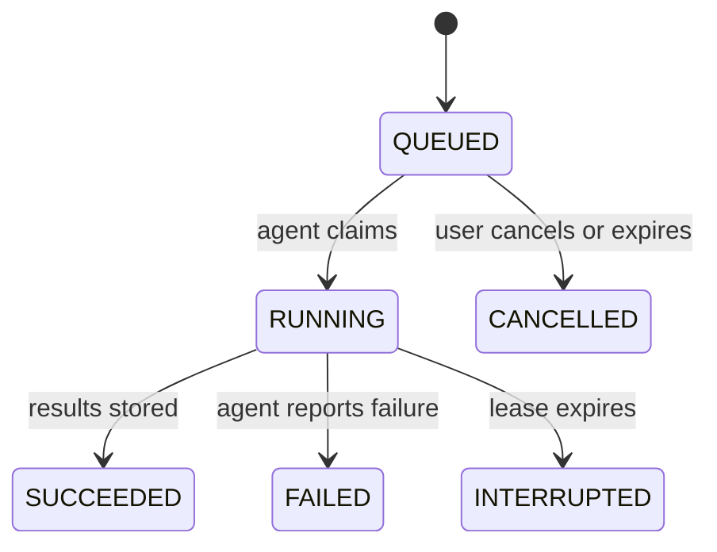
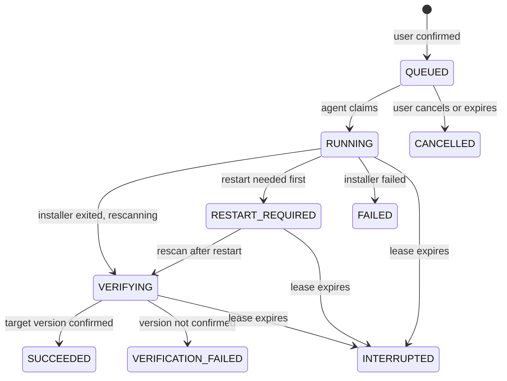

# UpdatePilot: Job State Machine

Status: Draft for team review (Day 4)
Code: `packages/shared/src/job-state.ts` (with tests in `job-state.test.ts`)
Related: `docs/openapi.yaml`, `docs/agent-protocol.md`, `docs/threat-model.md`

Scans and updates run as jobs with persistent status and timestamps. Long operations never block a web request.

## 1. States

| State                 | Meaning                                                                                        | Terminal |
| --------------------- | ---------------------------------------------------------------------------------------------- | -------- |
| `QUEUED`              | Created and waiting for the agent to pick it up                                                | No       |
| `RUNNING`             | The agent claimed the job and is working                                                       | No       |
| `VERIFYING`           | Update only: the agent is rescanning to confirm the installed version                          | No       |
| `RESTART_REQUIRED`    | Update only: installer finished but Windows needs a restart before the version can be verified | No       |
| `SUCCEEDED`           | Scan finished, or update finished **and the rescan shows the target version**                  | Yes      |
| `FAILED`              | The operation failed (non-zero exit code, installer error, timeout of the process)             | Yes      |
| `CANCELLED`           | Stopped by the user before it started, or expired while queued                                 | Yes      |
| `INTERRUPTED`         | The agent disconnected or stopped reporting while the job was active                           | Yes      |
| `VERIFICATION_FAILED` | The installer reported success but the rescan does not show the target version                 | Yes      |

These map one-to-one to the status badges in `docs/design-system.md`.

## 2. Transitions

### 2.1 Scan jobs

### 2.2 Update jobs

### 2.3 Allowed transitions (table form)

| From               | Scan job may go to                   | Update job may go to                                     |
| ------------------ | ------------------------------------ | -------------------------------------------------------- |
| `QUEUED`           | `RUNNING`, `CANCELLED`               | `RUNNING`, `CANCELLED`                                   |
| `RUNNING`          | `SUCCEEDED`, `FAILED`, `INTERRUPTED` | `VERIFYING`, `RESTART_REQUIRED`, `FAILED`, `INTERRUPTED` |
| `VERIFYING`        | none                                 | `SUCCEEDED`, `VERIFICATION_FAILED`, `INTERRUPTED`        |
| `RESTART_REQUIRED` | none                                 | `VERIFYING`, `INTERRUPTED`                               |
| Terminal states    | none                                 | none                                                     |

Anything not listed is rejected with `409 INVALID_STATE`.

Notes:

- **Success always passes through `VERIFYING`.** There is no direct path from `RUNNING` to `SUCCEEDED` for updates.
- **A running update cannot be cancelled** in the MVP. Once an installer has started, stopping it midway can leave software broken. The user can only cancel while the job is `QUEUED`.
- **When the agent's result already includes the rescan,** the API still records both steps (`RUNNING` to `VERIFYING`, then to the final state) in one transaction, with one audit event for each.

## 3. Who triggers each transition

| Transition                        | Triggered by                             | Where                                                               |
| --------------------------------- | ---------------------------------------- | ------------------------------------------------------------------- |
| Job created as `QUEUED`           | User (scan request, or confirmed update) | `POST /devices/{id}/scans`, `POST /updates/{id}/execute`            |
| `QUEUED` to `RUNNING`             | Agent                                    | `GET /agent/jobs/next` (atomic claim)                               |
| `RUNNING` to `VERIFYING`          | Agent                                    | `POST /agent/jobs/{id}/progress` or the result endpoint             |
| Final states from the agent       | Agent                                    | `POST /agent/scans/{id}/results`, `POST /agent/updates/{id}/result` |
| `QUEUED` to `CANCELLED` (user)    | User                                     | Cancel action (added when the Update Center is built)               |
| `QUEUED` to `CANCELLED` (expired) | System                                   | Cleanup task                                                        |
| Active to `INTERRUPTED`           | System                                   | Lease timeout task                                                  |

## 4. Concurrency and idempotency rules

1. **Atomic transitions.** Every state change is a compare-and-set in the database:
   `UPDATE ... SET state = <new> WHERE id = <id> AND state = <expected>`. If zero rows change, the request returns `409 INVALID_STATE`. Two agents or two requests cannot both win.
2. **One active update per application.** Before creating an update job, the API checks inside the same transaction that no job for that application is in `QUEUED`, `RUNNING`, `VERIFYING` or `RESTART_REQUIRED` (`ACTIVE_UPDATE_STATES` in code). Otherwise `409 INVALID_STATE`.
3. **Scan requests.** An `Idempotency-Key` header makes retries safe. The same key returns the original job. The same key with a different device returns `409 IDEMPOTENCY_CONFLICT`.
4. **Update requests.** The `jti` inside the signed `previewToken` is stored as the job's `idempotencyKey`. A token can therefore create at most one job, a repeated request returns that job, and a replayed token cannot start a second update.
5. **Agent results are idempotent.** Sending the same result again for a job that is already in the matching final state returns `200` with that job. A conflicting result for a finished job returns `409 INVALID_STATE` and writes an audit event.
6. **Terminal means final.** A terminal job is never reopened. A retry is always a **new** job.

## 5. Time limits

Values are configuration, not constants. Defaults to start with, to be tuned against real hardware in Weeks 3 and 4:

| Limit                                                | Default                                     | Result when exceeded                     |
| ---------------------------------------------------- | ------------------------------------------- | ---------------------------------------- |
| Waiting in `QUEUED`                                  | 15 minutes                                  | `CANCELLED` (reason: expired)            |
| Agent silence while `RUNNING` or `VERIFYING` (lease) | 2 minutes without a poll or progress report | `INTERRUPTED`                            |
| Scan duration                                        | 5 minutes                                   | Agent reports `FAILED`                   |
| Update duration                                      | 30 minutes                                  | Agent stops waiting and reports `FAILED` |
| Preview token lifetime                               | 5 minutes                                   | `422 UPDATE_CHANGED`                     |

## 6. Deciding the final state of an update

The agent reports facts. The server decides the state, using `decideUpdateOutcome` in the shared package.

| Exit code          | Restart flagged | Rescan shows target version | Final state           | Verification |
| ------------------ | --------------- | --------------------------- | --------------------- | ------------ |
| 0                  | no              | yes                         | `SUCCEEDED`           | `VERIFIED`   |
| 0                  | no              | no, or version unreadable   | `VERIFICATION_FAILED` | `FAILED`     |
| restart-style code | yes             | yes                         | `SUCCEEDED`           | `VERIFIED`   |
| restart-style code | yes             | no                          | `RESTART_REQUIRED`    | `NOT_RUN`    |
| non-zero           | no              | any                         | `FAILED`              | `NOT_RUN`    |

Principles:

- **Never report success prematurely.** A zero exit code alone is not success.
- A restart-style code means the installer reported that a reboot is needed (Windows installers commonly use 3010). The exact codes WinGet returns must be confirmed against real output in Week 3, so the agent maps them to the `restartRequired` flag and the API only sees the flag.
- Equality with the target version is used for now. In Week 4 the version comparison module replaces it so that a newer version than the target also counts as verified.

## 7. Failure handling and retry

| State                 | What the UI shows                                                      | Retry                                                                                    |
| --------------------- | ---------------------------------------------------------------------- | ---------------------------------------------------------------------------------------- |
| `FAILED`              | Reason, exit code, safe next steps                                     | Allowed after a **new preview**, if the package source is unchanged and no job is active |
| `INTERRUPTED`         | "The agent stopped responding. The software may be partially updated." | Allowed after a fresh scan shows the current version, then a new preview                 |
| `CANCELLED`           | Cancelled or expired                                                   | Allowed (new job)                                                                        |
| `VERIFICATION_FAILED` | "Installer finished but the version was not confirmed"                 | Not offered automatically. Suggest a rescan first                                        |
| `RESTART_REQUIRED`    | "Restart Windows to finish. UpdatePilot will verify afterwards."       | Not applicable. Verification happens after restart                                       |

Retry never reuses a job or a preview token.

## 8. Audit events per transition

| Event                            | Written when                                           |
| -------------------------------- | ------------------------------------------------------ |
| `SCAN_REQUESTED`                 | Scan job created                                       |
| `SCAN_COMPLETED` / `SCAN_FAILED` | Scan reaches a final state                             |
| `UPDATE_PREVIEWED`               | Preview token issued                                   |
| `UPDATE_CONFIRMED`               | Update job created                                     |
| `UPDATE_STARTED`                 | Agent claims the update (`RUNNING`)                    |
| `UPDATE_COMPLETED`               | Installer finished (`VERIFYING` or `RESTART_REQUIRED`) |
| `UPDATE_VERIFIED`                | `SUCCEEDED`                                            |
| `UPDATE_VERIFICATION_FAILED`     | `VERIFICATION_FAILED`                                  |
| `UPDATE_FAILED`                  | `FAILED` or `INTERRUPTED`                              |

Each event records actor, device, target, timestamp and safe metadata only.

## 9. Test plan (unit tests already written)

- Every allowed transition is accepted and every other one is rejected.
- Terminal states have no outgoing transitions.
- No path from `RUNNING` to `SUCCEEDED` for updates.
- Outcome decision table in section 6, including the case that a non-zero exit code never yields success.

Added in Week 5: concurrency tests (two agents claiming one job, a replayed execute request, a duplicate result).
